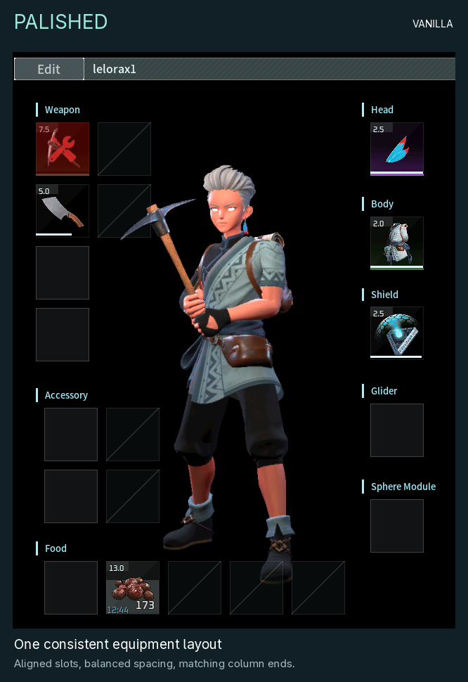
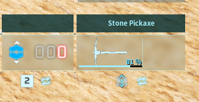

# Palished

_Small details. Smoother everyday play._

Keep an eye on your tool's durability, repair with a keypress, and enjoy tidier
equipment slots that fit Palworld's existing interface.

## A cleaner inventory

Aligned slots, consistent section spacing, and a right column that ends level
with your accessories. Palworld's native styling, slot sizes and controls stay intact.

_Native UI renders: original layout → Palished. Both columns and the accessory/food slots are included._

## Durability at a glance

A compact bar and percentage show your equipped tool or weapon's condition.
Red below 20%, like the game's own gauge. Empty hands get Palworld's native fist icon
and localized **Unarmed** label.

## Quick repairs

At a repair bench, **R** repairs the selected item and **Ctrl+R** opens the normal
**Repair All** confirmation. The buttons show the shortcuts alongside their
localized labels. Repair costs stay unchanged.

## Getting started

**Client only.** Requires a compatible [UE4SS loader for Palworld](https://www.nexusmods.com/palworld/mods/2237).

1. Close Palworld.
2. Copy `Palished` into your existing UE4SS `Mods` folder.
3. UE4SS hot reload uses Ctrl+R by default. Set `EnableHotReloadSystem = 0` in `UE4SS-settings.ini`, or change `HotReloadKey`.
4. Restart the game.

Updating from 1.1.2 or earlier? Delete the old mod folder and its mods-list line
first; see `INSTALL.txt`. Tested on Palworld 1.0.5.102999 with UE4SS 2281fa31
through Proton/Wine; other versions and UI mods may need adjustments.

## Share your experience

We'd love to hear which little details make a difference for you! Leave a comment,
share your experience, or [report a bug](https://github.com/PikouGame/Palished/issues)
so we can investigate and improve Palished together.

[Source and compatibility notes](https://github.com/PikouGame/Palished)

_Made with OpenAI Codex and Claude under lelorax's direction. Screenshots are captured in game.
Free to use; all rights reserved. Reuploads, published modifications and reuse
require permission. Unofficial Palworld mod._
